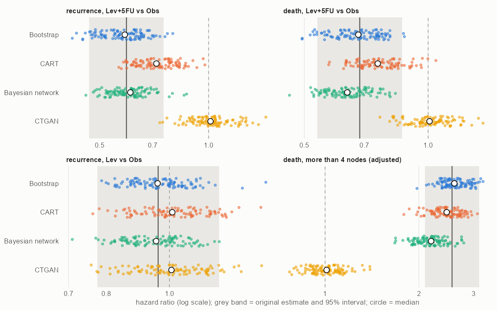

# Synthetic copies of a colon cancer trial: do they reproduce its findings?

Synthetic patient data are proposed for sharing clinical data and for augmenting small studies. Before using them, an analyst needs to know whether the main analyses of a study come out the same on a synthetic copy. This project tests that on a completed randomized trial with known results, the colon cancer adjuvant chemotherapy trial in the R package survival (888 patients with complete data: observation, levamisole, or levamisole plus fluorouracil).

Three generators make 100 copies each: sequential CART (synthpop), a Bayesian network learned by hill climbing (bnlearn), and a conditional tabular GAN (CTGAN). The nonparametric bootstrap makes 100 resamples as the classical benchmark. Every copy is put through the same four Cox models: the treatment effect on recurrence and on death, the null effect of levamisole alone, and the prognostic effect of more than four positive nodes. The copies are also scored for fidelity (propensity-score utility, Kaplan-Meier and marginal distances), for two structural rules of the data (recurrence cannot follow death, and patients without recurrence are censored at their last follow-up), and for privacy (copied patients, distance to the closest patient). The checks and their thresholds were written down before any copy was made: [docs/design.md](docs/design.md). The readout is [docs/readout.md](docs/readout.md).

Only the bootstrap reproduced all four findings. The Bayesian network kept both treatment effects but shrank the nodal hazard ratio from 2.56 to 2.19. CART came closest to the original on every fidelity measure, yet pulled the treatment effect on recurrence from 0.59 to 0.72, and a quarter of its copies lost significance. CTGAN at its default settings learned almost no relationships at this sample size (every hazard ratio near 1.01). Training it ten times longer, a post hoc run, improved fidelity but gave erratic effects. Every generator broke the structural rules in a quarter to half of its rows, and none copied a patient. Stacking a copy onto the real data narrowed every interval by about 30% without adding any information.

| finding (original HR) | bootstrap | CART | Bayesian network | CTGAN |
|---|---|---|---|---|
| recurrence, Lev+5FU (0.59) | reproduced | not | reproduced | not |
| death, Lev+5FU (0.68) | reproduced | not | not (median 0.58 SE off) | not |
| recurrence, Lev alone (0.96) | reproduced | reproduced | reproduced | reproduced |
| death, more than 4 nodes (2.56) | reproduced | reproduced | not | not |

"Reproduced" means that at least 80% of copies reach the original conclusion, the median estimate is within half a standard error of the original, and at least 90% of intervals cover it.



## Run

From the project folder, with R 4.4 (packages survival, synthpop, bnlearn, cluster, ggplot2, testthat) and Python 3.12 (`pip install -r python/requirements.txt`):

```
Rscript scripts/01_data.R
Rscript scripts/02_generate.R
python python/ctgan_generate.py --data data/colon.csv --out data/synthetic/ctgan --reps 100 --workers 8
Rscript scripts/03_evaluate.R
Rscript scripts/04_verdicts.R
Rscript scripts/05_figures.R
python python/ctgan_generate.py --data data/colon.csv --out data/synthetic/ctgan_e3000 --reps 20 --workers 10 --epochs 3000
Rscript scripts/06_posthoc_ctgan.R
Rscript -e "testthat::test_dir('tests')"
```

On a 20-core laptop the R generators take about 2.5 minutes, the 100 CTGAN fits about 20 minutes on 8 workers, the evaluation about 11 minutes and the post hoc run about 30 minutes. ctgan's data transformer starts one joblib process per core for tables above 500 rows, which exhausted memory with several workers, so the script runs that step sequentially inside each worker; the model and its defaults are unchanged.

The generators share one interface (a data frame and a seed in, a copy of the same shape out), and the evaluation in `R/analysis.R` and `R/metrics.R` takes any copy with these columns, so another generator can be added by writing one function.

## Data

`colon` from the R package survival 3.8.3 (LGPL), from the trial reported by Laurie et al. (Journal of Clinical Oncology, 1989) and Moertel et al. (New England Journal of Medicine, 1990). The generated copies under `data/` are not committed; the scripts rebuild them. The code is under the MIT license.

Can Zhang, zhan8639@umn.edu
