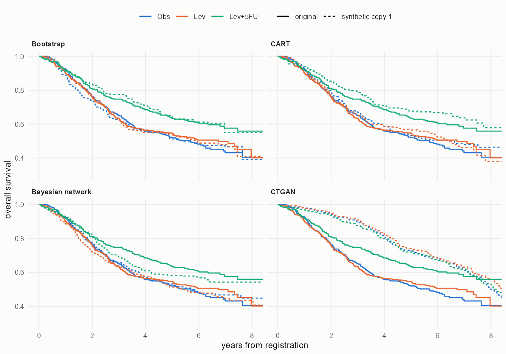

# Readout: synthetic copies of the colon cancer adjuvant trial

The plan is [design.md](design.md), written and committed before any synthetic data set existed; Amendment 1 changed one descriptive measure after a two-copy smoke test. Everything marked post hoc was decided after the results below were seen.

## Reference

On the 888 patients with complete data, levamisole plus fluorouracil lowered the hazard of recurrence (HR 0.59, 95% CI 0.47 to 0.75) and of death (0.68, 0.54 to 0.86), levamisole alone did not change recurrence (0.96, 0.77 to 1.19), and more than four positive nodes carried a hazard ratio for death of 2.56 (2.10 to 3.12) after adjustment.

## Do the copies give the same answers?

Median hazard ratio over 100 copies, then the share of copies that reach the original conclusion (C1) and the share whose 95% interval covers the original estimate (C3).

| finding | original | bootstrap | CART | Bayesian network | CTGAN |
|---|---|---|---|---|---|
| F1 recurrence, Lev+5FU | 0.59 | 0.59 (99%, 91%) | 0.72 (75%, 61%) | 0.61 (98%, 95%) | 1.01 (3%, 1%) |
| F2 death, Lev+5FU | 0.68 | 0.68 (93%, 90%) | 0.75 (62%, 87%) | 0.64 (96%, 95%) | 1.01 (2%, 10%) |
| F3 recurrence, Lev | 0.96 | 0.96 (96%, 98%) | 1.01 (95%, 90%) | 0.95 (95%, 98%) | 1.01 (92%, 93%) |
| F4 death, > 4 nodes | 2.56 | 2.60 (100%, 97%) | 2.46 (100%, 91%) | 2.19 (100%, 63%) | 1.01 (4%, 0%) |

Verdicts against the design (C1 to C3 must all hold for a finding to count as reproduced):

- **Bootstrap** reproduced all four findings. Its coverage for F2 was 90%, exactly at the threshold.
- **CART** reproduced F3 and F4 and failed F1 and F2. It pulled both treatment effects toward 1: the median estimate for F1 was 1.6 original standard errors from the original, and only 75% and 62% of copies kept the two effects significant.
- **Bayesian network** reproduced F1 and F3. F2 missed C2 narrowly (the median was 0.58 standard errors from the original, against a limit of 0.5; C1 and C3 held), and F4 failed: the nodal hazard ratio shrank to 2.19 and only 63% of intervals covered 2.56.
- **CTGAN** reproduced only F3, the finding of no effect, and only because its copies held no effects at all: every hazard ratio was close to 1.01.

No generator reproduced the trial. The other checks:

| check | CART | Bayesian network | CTGAN |
|---|---|---|---|
| C4 SD of log HR vs bootstrap (<= 1.5) | 0.90 to 1.15, met | 0.88 to 1.12, met | 0.85 to 1.27, met |
| C5 recurrence after death, V1 (<= 1%) | 23.9%, failed | 31.5%, failed | 42.7%, failed |
| C5 no recurrence but times differ, V2 (<= 1%) | 43.5%, failed | 50.0%, failed | 48.4%, failed |
| C6 rows identical to a patient (<= 5%) | 0.2%, met | 0.003%, met | 0.001%, met |

All bootstrap rows are real patients, by construction.

## Fidelity

Means over 100 copies. S_pMSE is about 1 when a classifier cannot tell the copy from the original better than chance; the other measures are distances, 0 for an identical copy. The Kaplan-Meier distance is the largest gap within an arm over the first five years.

| measure | bootstrap | CART | Bayesian network | CTGAN |
|---|---|---|---|---|
| S_pMSE | 1.04 | 2.09 | 3.26 | 12.43 |
| total variation, categorical | 0.012 | 0.013 | 0.013 | 0.037 |
| Kolmogorov-Smirnov, continuous | 0.026 | 0.027 | 0.034 | 0.222 |
| Kaplan-Meier, recurrence | 0.058 | 0.066 | 0.067 | 0.245 |
| Kaplan-Meier, death | 0.055 | 0.061 | 0.063 | 0.257 |
| Spearman correlations | 0.026 | 0.031 | 0.047 | 0.108 |
| distance to closest patient (Gower, median) | 0 | 0.022 | 0.028 | 0.086 |

CART came closest to the original on every fidelity measure, almost as close as the bootstrap, and still missed the main treatment effect. Fidelity summaries do not show whether a particular analysis will come out the same.

## Expectations written in advance

- CART will have the best fidelity: held.
- The Bayesian network will weaken the treatment effects: wrong. It kept both treatment effects and weakened the prognostic factor instead.
- CTGAN will do worst: held.
- Every generator will give more variable estimates than the bootstrap: wrong. The standard deviations were 0.85 to 1.27 times the bootstrap's. CART and the Bayesian network fit the same model every time, so the variation between copies comes from drawing 888 rows, as in the bootstrap.

## Why each generator went wrong (diagnostics, post hoc)

- **Bayesian network.** Hill climbing kept 10 arcs. The arm is joined only to recurrence status, which is enough for the treatment effects. Age, sex, obstruction and time to registration are joined to nothing, and the node count reaches death only through death status (death status to node count to node4), so the adjusted nodal effect weakens.
- **CART.** The fitted tree for recurrence status splits on recurrence time, obstruction, age, time to registration and node count but never on the arm. Whatever the arm says about who recurs, beyond when, does not reach the copy. The trees are the same in every replicate.
- **CTGAN.** With 888 rows and a batch size of 500, the default 300 epochs give about 600 gradient steps. In copy 1 the correlation between death time and death status was -0.01, against -0.83 in the original.

Post hoc, 20 copies were made with 3,000 epochs (`scripts/06_posthoc_ctgan.R`). Fidelity improved (S_pMSE 6.8, Kolmogorov-Smirnov 0.11, Kaplan-Meier 0.11), but the findings did not come back reliably: F1 and F2 reached the original conclusion in 80% of copies with 75% coverage, levamisole alone reached p < 0.05 in 25% of copies, and the nodal hazard ratio was exaggerated to 3.89, with 5% coverage. Longer training buys fidelity, not trustworthy effect estimates, at this sample size.

## Augmenting the original

Stacking a copy onto the 888 patients narrowed every interval to 0.68 to 0.72 of its original width, for the bootstrap as much as for the generators, because the model counts 1,776 patients where there are 888. The point estimate moved toward the copy: with CTGAN the nodal effect moved 4.3 original standard errors toward 1, and with CART the recurrence effect moved 0.8. Synthetic rows added to real ones look like extra information and are not.

## Recommendations for synthetic clinical data

1. Judge a synthetic data set by the analyses it has to support, refitted on many copies, not only by fidelity summaries.
2. Encode structural rules in the generator or check and repair them: a quarter to half of the rows from every generator broke rules that hold for every patient.
3. Make sure the generator links the treatment arm to the outcomes, for example through the predictor matrix in synthpop or required arcs in the Bayesian network. Not tested here.
4. Do not stack synthetic rows onto real ones for inference. When inference from synthetic data is needed, use several copies and combining rules made for it (Raab, Nowok and Dibben 2016), and confirm key results on the real data.
5. Do not trust GAN defaults on trial-sized data. Check the number of training steps and validate the copies as above.
6. For the question "would this result hold in another sample like this one?", the bootstrap stays the reference. The case for synthetic data here is sharing: no generator reproduced a patient.

## Limitations

One trial, one data size and four findings, so the ranking of generators may not carry over to other data. The generators ran at their default settings, as planned; tuning could change the CART and CTGAN results. The original 888 patients are both the training data and the reference, so the checks measure reproduction of this data set's results, not of the true treatment effect.

## References

- Laurie JA, et al. Surgical adjuvant therapy of large-bowel carcinoma: an evaluation of levamisole and the combination of levamisole and fluorouracil. Journal of Clinical Oncology 1989;7:1447-1456.
- Moertel CG, et al. Levamisole and fluorouracil for adjuvant therapy of resected colon carcinoma. New England Journal of Medicine 1990;322:352-358.
- Nowok B, Raab GM, Dibben C. synthpop: bespoke creation of synthetic data in R. Journal of Statistical Software 2016;74(11).
- Raab GM, Nowok B, Dibben C. Practical data synthesis for large samples. Journal of Privacy and Confidentiality 2016;7(3).
- Scutari M. Learning Bayesian networks with the bnlearn R package. Journal of Statistical Software 2010;35(3).
- Snoke J, Raab GM, Nowok B, Dibben C, Slavkovic A. General and specific utility measures for synthetic data. Journal of the Royal Statistical Society Series A 2018;181:663-688.
- Xu L, Skoularidou M, Cuesta-Infante A, Veeramachaneni K. Modeling tabular data using conditional GAN. NeurIPS 2019.
